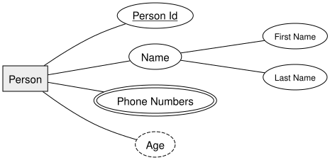
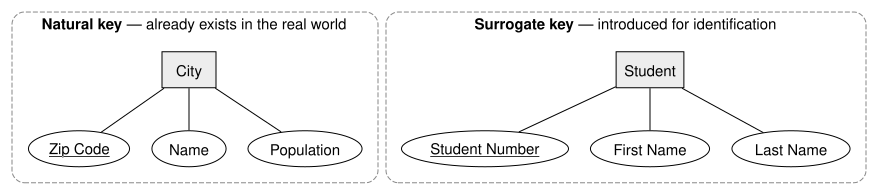
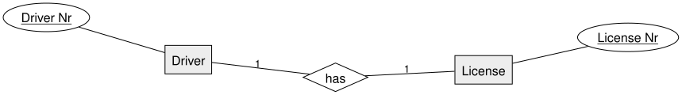
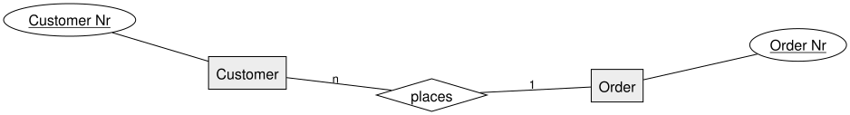
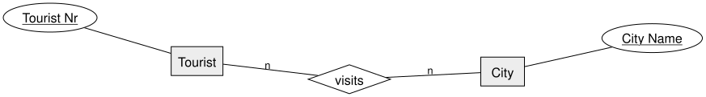

= ERM Fundamentals | Chen Notation — DBI 3xHIF
:title-separator: |
:lang: en
:revealjs_theme: white
:revealjs_width: 1280
:revealjs_height: 720
:revealjs_transition: none
:revealjs_hash: true
:source-highlighter: highlightjs
:title-slide-background-color: #ED1944
:revealjs_slideNumber: c/t

== Agenda

[arabic]
. From Tables to Entities
. Entity, Relationship, Attribute
. Attribute Types
. Keys
. Cardinality: 1:1, 1:n, n:m
. Summary

== Learning Goals

* I can identify entities, relationships, and attributes in a scenario
* I can draw them using Chen notation (rectangle, diamond, oval)
* I can distinguish key, composite, multivalued, and derived attributes
* I can determine and notate 1:1, 1:n, and n:m cardinalities

== Recap: From Tables to Entities

Last lesson we turned a prose specification into plain tables by hand, and talked +
about primary and foreign keys.

Today we give that process a *formal notation*: the *Entity-Relationship Model +
(ERM)*, introduced by Peter Chen in 1976.

An ERM diagram describes the *static structure* of data — independent of any +
specific database product.

== The Three Building Blocks

[width="100%",cols="34%,33%,33%",options="header",]
|===
|Concept |Meaning |Notation
|*Entity* |A distinguishable thing in the real world (Student, Car, Order) |Rectangle
|*Relationship* |A meaningful association between entities (writes, supervises) |Diamond
|*Attribute* |A property describing an entity or relationship (name, date) |Oval
|===

An *entity set* groups similar entities (all students); a single student is one _entity_.

== Example: Entity with Attributes

== Attribute Types

* *Key attribute* — uniquely identifies each entity → underlined
* *Composite attribute* — made up of smaller parts → `Name` splits into `First Name` / `Last Name`
* *Multivalued attribute* — an entity can have several values → double oval (`Phone Numbers`)
* *Derived attribute* — computed from other data, not stored → dashed oval (`Age` from birth date)

== Keys

* A *key* is a minimal set of attributes that uniquely identifies an entity
* An entity type can have several *key candidates* — one is chosen as the *primary key*, the rest are secondary keys
* Example: entity `City` — attributes `ZIP`, `Country`, `Population`, `Area Code` — both `ZIP` and `Area Code` could serve as a key

== Key Properties

[arabic]
. Unique
. Not Null
. Stable
. Minimal

== Unique

* A *key* must be one or multiple columns that uniquely identify an entity.
* Good example: entity `Student` is uniquely identified by `StudentNumber`
* Bad example: entity `Student` uses `Firstname` as identifier (duplicates!)

== Unique — Example

*Good:* `StudentNumber` as key — every row is distinguishable

[cols=",,",options="header",]
|===
|*StudentNumber* |Firstname |Lastname
|1001 |Anna |Huber
|1002 |Anna |Gruber
|===

*Bad:* `Firstname` as key — two students share the value `Anna`

[cols=",",options="header",]
|===
|*Firstname* |Lastname
|Anna |Huber
|Anna |Gruber
|===

== Not Null

* A *key* must never be NULL
* Good example: entity `Student` is uniquely identified by `StudentNumber`
* Bad example: entity `Student` uses `SocialSecurityNumber` as identifier (may be null!)

== Not Null — Example

*Good:* `StudentNumber` as key — always filled in

[cols=",,",options="header",]
|===
|*StudentNumber* |Firstname |Lastname
|1001 |Anna |Huber
|1002 |Ben |Gruber
|===

*Bad:* `SocialSecurityNumber` as key — not every student has one yet

[cols=",,",options="header",]
|===
|*SocialSecurityNumber* |Firstname |Lastname
|1234 010203 |Anna |Huber
|NULL |Ben |Gruber
|NULL |Carla |Maier
|===

== Stable

* A *key* must never change
* Good example: entity `Student` is uniquely identified by `StudentNumber` (once assigned, never changes)
* Bad example: entity `Student` uses `Email` as identifier (may change at some point)

== Stable — Example

*Good:* `StudentNumber` as key — the email changes, the identity stays

[cols=",,",options="header",]
|===
| |*StudentNumber* |Email
|before |1001 |anna.huber@school.at
|after |1001 |anna.gruber@school.at
|===

*Bad:* `Email` as key — the key itself has to change

[cols=",,",options="header",]
|===
| |*Email* |StudentNumber
|before |anna.huber@school.at |1001
|after |anna.gruber@school.at |1001
|===

Every row referencing the old email is now orphaned.

== Minimal

* A *key* must be as small as possible
* Good example: entity `Student` is uniquely identified by `StudentNumber` alone
* Bad example: entity `Student` is identified by `Firstname`, `Lastname` and `Birthdate`
* ... One student might be inserted more than once with various name/birthdate combinations

== Minimal — Example

*Good:* `StudentNumber` alone is enough

[cols=",,,",options="header",]
|===
|*StudentNumber* |Firstname |Lastname |Birthdate
|1001 |Anna |Huber |2007-03-12
|===

*Bad:* `Firstname` {plus} `Lastname` {plus} `Birthdate` — more columns than needed, and a typo creates a "second" Anna

[cols=",,",options="header",]
|===
|*Firstname* |*Lastname* |*Birthdate*
|Anna |Huber |2007-03-12
|Anna |Huber |2007-03-21
|===

== Two types of keys

When modeling our entities, we need to think about the kind of key we want to use:

* *Natural* key
* *Surrogate* key

== Natural Key

A *natural key* is part of the attributes of an entity.

* Example: entity `City` uses `ZipCode` as primary key
* ... each city has one zip code already

== Surrogate Key

A *surrogate key* is added to the entity for the _purpose_ of identification.

* Example: entity `Student` uses new attribute `StudentNumber` as primary key
* ... `StudentNumber` doesn't exist naturally on a student - it was *introduced*

== Natural vs. Surrogate — Example

A city already _has_ a zip code. A student has no number until the school _hands one out_.

== Pitfalls

[.highlight-box]
--
*surrogate* =/= *artificial*
--

For a `Student` entity, `SocialSecurityNumber` would be _natural_, as it is already _given_.

For the social security institute, `SocialSecurityNumber` is a _surrogate_ key, as they _introduce_ it.

== Pitfall — Example

Same attribute, two different verdicts:

[width="100%",cols="25%,25%,25%,25%",options="header",]
|===
|Entity |Key |Where does the value come from? |Verdict
|`Student` |`SocialSecurityNumber` |already exists — the school just records it |*natural*
|`Insured Person` |`SocialSecurityNumber` |issued by the institute when a person registers |*surrogate*
|===

A key that feels _natural_ can still be a surrogate — it depends on *who introduced it*, not on how "real" it feels.

== Cardinality

Cardinality describes *how many* instances of one entity relate to instances of another, through a relationship.

Three basic shapes:

* *1:1* — one-to-one
* *1:n* — one-to-many
* *n:m* — many-to-many

== 1:1 — Driver has License

Each driver has exactly one license; each license belongs to exactly one driver.

== 1:n — Customer places Order

A customer can place many orders (or none); each order belongs to exactly one customer.

== n:m — Tourist visits City

A tourist visits many cities; a city is visited by many tourists.

[.invert,background-color="#1A1A1A"]
== Summary

* *Entity* = rectangle · *Relationship* = diamond · *Attribute* = oval
* Attributes can be *key*, *composite*, *multivalued*, or *derived*
* Cardinality — *1:1*, *1:n*, *n:m* — describes how entities relate through a relationship
* You now have every building block needed to model your own scenario in Chen notation
