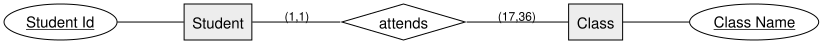
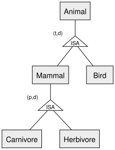
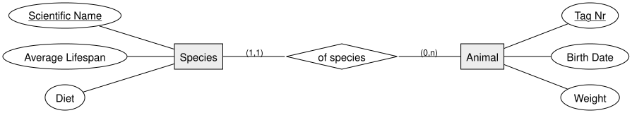

= IS-A Relationships & Min-Max Notation | DBI 3xHIF
:title-separator: |
:lang: en
:revealjs_theme: white
:revealjs_width: 1280
:revealjs_height: 720
:revealjs_transition: none
:revealjs_hash: true
:source-highlighter: highlightjs
:title-slide-background-color: #ED1944
:revealjs_slideNumber: c/t

== Agenda

[arabic]
. Recap
. Min-Max Notation
. IS-A / Generalization-Specialization
. Total vs. Partial, Disjoint vs. Overlapping
. Worked Example: Zoo Animals
. Instance vs. Type Attributes
. Summary

== Learning Goals

* I can read and write (min,max) cardinality pairs
* I can model a generalization/specialization hierarchy using ISA notation
* I can classify a specialization as total/partial and disjoint/overlapping
* I can distinguish attributes that describe an individual instance from attributes that describe its type

== Recap

So far we labeled relationships with *1:1*, *1:n*, or *n:m* — good for a quick +
overview, but it doesn't say *exactly how many*.

Today: a more precise notation, plus a new tool for modeling "is a kind of" +
relationships between entities.

== Min-Max Notation

A *(min,max)* pair is placed on the edge next to each entity. It states: _how many +
relationship instances does one entity instance participate in, at minimum and at +
maximum?_

* Near *Student*: `(1,1)` — every student attends *exactly one* class
* Near *Class*: `(17,36)` — every class has *between 17 and 36* students

== Min-Max vs. 1:1 / 1:n / n:m

[cols=",,",options="header",]
|===
|Classic |Min-Max |Meaning
|1:1 |(1,1) / (1,1) |exactly one on both sides
|1:n |(0,1) / (0,n) |optional on one side, many on the other
|n:m |(0,n) / (0,m) |many on both sides
|===

Min-max is *strictly more expressive* — it can say "at least 17, at most 36", +
something 1:n alone cannot.

== IS-A / Generalization-Specialization

An *ISA relationship* models "is a kind of": a *superclass* groups common +
attributes; *subclasses* add their own attributes and *inherit* everything from +
the superclass.

* Notation: a triangle labeled *ISA*, superclass above, subclasses below
* Every subclass entity *is also* a superclass entity — attributes are shared, not duplicated

== Total vs. Partial, Disjoint vs. Overlapping

Two independent questions for every ISA relationship:

* *Total (t)* — every superclass instance belongs to _at least one_ subclass +
*Partial (p)* — some superclass instances belong to _no_ subclass
* *Disjoint (d)* — an instance belongs to _at most one_ subclass +
*Overlapping (o)* — an instance may belong to _several_ subclasses at once

== Total + Disjoint (t,d)

Every superclass entity belongs to *exactly one* subclass.

* Example: a `Patient` must be *either* an `Outpatient` *or* an `Inpatient`
* No patient without a subclass (total), no patient in both (disjoint)

== Total + Overlapping (t,o)

Every superclass entity belongs to *at least one* subclass, but *can belong to several*.

* Example: a `UniversityMember` must be a `Student`, `Staff`, *or both*
* No member without a subclass (total), but a working student is in both (overlapping)

== Partial + Disjoint (p,d)

An entity belongs to *at most one* subclass, but *could belong to none*.

* Example: a `Vehicle` may be a `Car` *or* a `Truck` — or neither (e.g. a bicycle)
* Some vehicles have no subclass (partial), none is in both (disjoint)

== Partial + Overlapping (p,o)

An entity can belong to *zero, one, or several* subclasses.

* Example: a `Person` may be an `Employee`, a `Customer`, both, or neither
* No restriction at all — the most permissive combination

== Worked Example: Zoo Animals

* `Animal` → `Mammal`/`Bird` — *(t,d)*: every recorded animal is a mammal or a bird, never both
* `Mammal` → `Carnivore`/`Herbivore` — *(p,d)*: not every mammal is classified further, and never both

== Instance vs. Type Attributes

Not every "kind of" split is an ISA relationship. Some attributes describe a *type* +
shared by many instances, others describe *one specific instance*.

All lions share the same average lifespan and diet as their species — but each +
individual animal has its own tag number, birth date, and weight.

[.invert,background-color="#1A1A1A"]
== Summary

* *(min,max)* notation is more precise than 1:1/1:n/n:m
* *ISA* models generalization/specialization: triangle, superclass above, subclasses below
* Every ISA is *total or partial*, and *disjoint or overlapping*
* Not every split is ISA — sometimes it's a *type vs. instance* relationship instead
