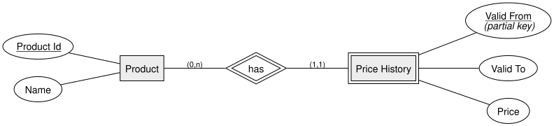
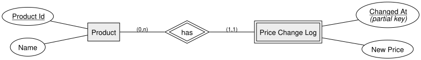

= Historization | DBI 3xHIF
:title-separator: |
:lang: en
:revealjs_theme: white
:revealjs_width: 1280
:revealjs_height: 720
:revealjs_transition: none
:revealjs_hash: true
:source-highlighter: highlightjs
:title-slide-background-color: #ED1944
:revealjs_slideNumber: c/t

== Agenda

[arabic]
. Recap
. Why Historize Data?
. Valid-Time vs. Transaction-Time
. Pattern 1: From-To
. Pattern 2: Log
. Summary

== Learning Goals

* I can explain why some data needs to keep its history
* I can distinguish valid-time from transaction-time
* I can model both the From-To pattern and the Log pattern

== Recap

So far, our models describe the *current* state of things. But some facts change +
over time, and we sometimes need to reconstruct what was true *in the past*.

== Why Historize Data?

*Historization* means recording how a value changed over time, instead of just +
overwriting it.

Without it, updating a value *destroys* the old one — but audits, reports, and +
"what was the price last month?" questions all need that old value back.

== Valid-Time vs. Transaction-Time

* *Valid time* — the period during which a fact was *true in the real world* +
(e.g. "this price applied from March to June")
* *Transaction time* — the moment we *recorded* that fact in the database

They often differ: we might enter a price change today that took effect last week.

== Pattern 1: From-To

Store each value together with the *period* it was valid for.

Querying "what was the price on date X?" means finding the row where +
`Valid From ≤ X ≤ Valid To`.

== Pattern 2: Log

Store just a *timestamp* and the new value, every time something changes.

The value valid "as of" a given moment is the *latest logged row* before that moment +
— simpler to write, slightly more work to query.

[.invert,background-color="#1A1A1A"]
== Summary

* Historization keeps old values instead of overwriting them
* *Valid time* (when it was true) and *transaction time* (when we recorded it) can differ
* *From-To* stores an explicit validity period; *Log* stores one timestamp per change
