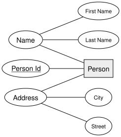
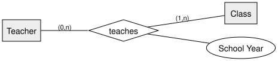

= Transforming ERM into a Relational Model | DBI 3xHIF
:title-separator: |
:lang: en
:revealjs_theme: white
:revealjs_width: 1280
:revealjs_height: 720
:revealjs_transition: none
:revealjs_hash: true
:source-highlighter: highlightjs
:title-slide-background-color: #ED1944
:revealjs_slideNumber: c/t

== Agenda

[arabic]
. The General Algorithm
. Rule: Composite Attributes
. Rule: Multivalued Attributes
. Rule: 1:1 Relationships
. Rule: 1:n Relationships
. Rule: n:m Relationships
. Summary

== Learning Goals

* I can apply the standard algorithm for transforming an ERM into relational tables
* I can transform composite and multivalued attributes correctly
* I can decide, for 1:1, 1:n, and n:m relationships, whether a foreign key or a new table is needed

== The General Algorithm

[arabic]
. Reduce every attribute to *1NF* — flatten composite attributes, move multivalued attributes into their own table
. Every *entity type* becomes its own table
. Every *relationship type* becomes its own table — *except* binary 1:1 and 1:n relationships, where a foreign key is folded into an existing table instead

== Rule: Composite Attributes

A composite attribute is simply *flattened*: each of its parts becomes its own column.

== Rule: Composite Attributes — Result

[cols="",options="header",]
|===
|p++_++person
|*Person Id* (PK)
|First Name
|Last Name
|Street
|City
|===

== Rule: Multivalued Attributes

A multivalued attribute *cannot* become a column — it becomes its own table, linked +
back by a foreign key.

[cols="",options="header",]
|===
|t++_++phone++_++numbers
|*Person Id* (PK, FK)
|*Phone Number* (PK)
|===

== Rule: 1:1 Relationships

Fold the foreign key into the side with the *more restrictive* cardinality — here, +
a class has at most one rep, so the FK goes on `Class`, with a unique constraint.

[cols="",options="header",]
|===
|k++_++class
|*Class Id* (PK)
|...
|Class Rep Student Id (FK, unique, nullable)
|===

== Rule: 1:n Relationships

Fold the foreign key into the *"many"* side — every student attends exactly one +
class, so `Student` gets the FK, and it can't be NULL.

[cols="",options="header",]
|===
|s++_++student
|*Student Id* (PK)
|...
|Class Id (FK, not null)
|===

== Rule: n:m Relationships

Neither side can hold the FK alone — an n:m relationship always becomes its *own* +
junction table, carrying both foreign keys (and any relationship attribute).

[cols="",options="header",]
|===
|u++_++teaches
|*Teacher Id* (PK, FK)
|*Class Id* (PK, FK)
|*School Year* (PK)
|===

[.invert,background-color="#1A1A1A"]
== Summary

* Reduce to 1NF first: flatten *composite* attributes, move *multivalued* attributes to their own table
* *1:1* and *1:n* relationships fold into a foreign key — *n:m* relationships always get their own table
* Every entity type becomes a table; only relationship tables can sometimes be avoided
