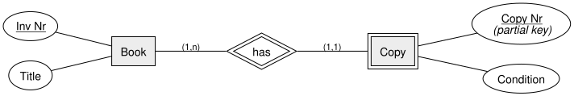
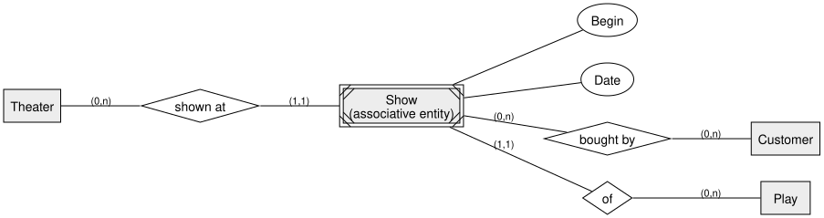
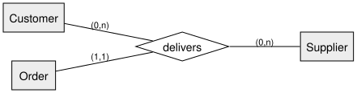

= Transforming EER into a Relational Model | DBI 3xHIF
:title-separator: |
:lang: en
:revealjs_theme: white
:revealjs_width: 1280
:revealjs_height: 720
:revealjs_transition: none
:revealjs_hash: true
:source-highlighter: highlightjs
:title-slide-background-color: #ED1944
:revealjs_slideNumber: c/t

== Agenda

[arabic]
. Recap
. Rule: Weak Entities
. Rule: Associative Entity Sets
. Rule: Ternary Relationships
. A First Look at IS-A
. Summary

== Learning Goals

* I can transform a weak entity into a table with a correct key
* I can transform an associative entity set, introducing a surrogate key where needed
* I can transform a ternary relationship into a junction table

== Recap

We already transform entities, binary relationships, and their attributes into +
tables. Today: three EER constructs that need a bit more care.

== Rule: Weak Entities

The weak entity's table gets a *composite key*: its own partial key *plus* the +
owner's primary key (as a foreign key).

[cols="",options="header",]
|===
|e++_++copy
|*Inv Nr* (PK, FK)
|*Copy Nr* (PK)
|Condition
|===

_(Alternative: give `Copy` its own surrogate key instead, with `Inv Nr` as a plain, not-null FK.)_

== Rule: Associative Entity Sets

`Show`'s "natural" key would be `(Theater Id, Play Id, Begin, Date)` — awkward to +
reference from `Ticket Purchase`. We introduce a *surrogate key* instead.

== Associative Entity: Result

[cols="",options="header",]
|===
|t++_++show
|*Show Id* (PK)
|Theater Id (FK)
|Play Id (FK)
|Begin
|Date
|===

[cols="",options="header",]
|===
|tp++_++ticket++_++purchase
|*Show Id* (PK, FK)
|*Customer Id* (PK, FK)
|===

== Rule: Ternary Relationships

A relationship with three participants becomes *one* junction table with *three* +
foreign keys.

[cols="",options="header",]
|===
|li++_++delivery
|*Customer Id* (FK)
|*Supplier Id* (FK)
|*Order Id* (PK, FK)
|===

== A First Look at IS-A

Transforming an ISA hierarchy needs its own set of rules — covered in full next +
lesson. For now, the key idea: a subclass table's primary key is *also* a foreign +
key referencing the superclass table (an *inclusion dependency*):

`Pilot++[++Employee Id++]++ ⊆ Employee++[++Employee Id++]++`

[.invert,background-color="#1A1A1A"]
== Summary

* A *weak entity* gets a composite key: partial key {plus} owner's PK (or its own surrogate key)
* An *associative entity set* often needs a *surrogate key* once its natural key becomes awkward
* A *ternary relationship* becomes one junction table with three foreign keys
