= 01 - Was ist Programmieren? | POS - 1xHIF
:title-separator: |
:lang: de
:revealjs_theme: white
:revealjs_width: 1280
:revealjs_height: 720
:revealjs_transition: none
:revealjs_hash: true
:source-highlighter: highlightjs
:title-slide-background-color: #ED1944
:revealjs_slideNumber: c/t

== Agenda (1/2)

[arabic]
. Was ist ein Programm?
. Programmiersprachen im Überblick
. Vorteile verschiedener Sprachen
. Kompiliert vs. interpretiert

== Agenda (2/3)

[arabic, start=5]
. Java - Das Beste aus beiden Welten?
. Die Java Virtual Machine (JVM)
. Java Compiler und JVM
. Computational Thinking

== Agenda (3/3)

[arabic, start=9]
. Algorithmus - Beispiel "Kaffee kochen"
. Flowchart - Ablauf visualisieren
. Leitfrage der Stunde

== Lernziele

* Ich kann erklären, was ein Programm ist und wie es abläuft
* Ich kann verschiedene Programmiersprachen vergleichen
* Ich kann die Java-Plattform (Compiler {plus} JVM) beschreiben
* Ich kann Algorithmen entwickeln und mit Flowcharts visualisieren
* Ich kann Computational Thinking als Problemlösungsmethode anwenden

== Was ist ein Programm?

* Ein Programm ist eine Folge von Anweisungen an den Computer
* Diese Anweisungen werden in einer Programmiersprache geschrieben
* Beispiele aus dem Alltag: Browser, Texteditor, Spiele, Navigations-App
* Ein Computer tut nichts ohne ein Programm

== Partneraktivität: Algorithmen im Alltag

[.highlight-box]
--
Denkt an eine alltägliche Aufgabe (Zähne putzen, Brot schmieren, …). Schreibt die Schritte als Algorithmus auf. Tauscht mit eurem Partner und prüft: Fehlen Schritte? Ist ein Schritt mehrdeutig?
--

== Programmiersprachen im Überblick

* Es gibt hunderte Programmiersprachen
* Jede hat ihre Stärken und Einsatzgebiete
* Beispiele: Java, Python, C{plus}{plus}, JavaScript, Kotlin, Swift
* Frage: Warum nicht einfach alle in einer Sprache schreiben?

== Vorteile verschiedener Sprachen

* Python -- einfach zu lernen, gut für Datenanalyse
* C / C{plus}{plus} -- schnell, hardwarenah (Spiele, Betriebssysteme)
* JavaScript -- läuft im Browser, Webentwicklung
* Java -- plattformunabhängig, grosses Ökosystem
* Kotlin -- moderne Alternative zu Java (Android)

== Kompiliert

* *Kompiliert:* Quellcode wird in Maschinencode uebersetzt
* Beispiele: C, C{plus}{plus}, Rust -- am Ende steht eine ausführbare Datei

== Interpretiert

* *Interpretiert:* Quellcode wird Zeile für Zeile ausgeführt
* Beispiele: Python, JavaScript -- kein separater Übersetzungsschritt
* Vorteil kompiliert: schneller, Fehler früher erkannt
* Vorteil interpretiert: flexibler, einfacher zu testen

== Java - Das Beste aus beiden Welten?

* Java ist *keine* rein kompilierte Sprache
* Java ist *keine* rein interpretierte Sprache
* Java kombiniert beide Ansätze

== Die Java Virtual Machine (JVM)

* Java-Quellcode (.java) wird zu Bytecode (.class) kompiliert
* Die JVM führt den Bytecode aus (interpretiert ihn)
* Die JVM ist selbst ein Programm -- eine "virtuelle Maschine"
* "Write once, run anywhere" -- einmal kompiliert, überall lauffähig

== Java Compiler und JVM

[source,java]
----
// Quellcode: Hallo.java
public class Hallo {
    public static void main(String[] args) {
        System.out.println("Hallo Welt!");
    }
}
----

....
// Kompilieren mit javac:
// javac Hallo.java -> erzeugt Hallo.class

// Ausführen mit JVM:
// java Hallo -> gibt "Hallo Welt!" aus
....

== Computational Thinking

* Problemlösen mit den Methoden der Informatik
* *Dekomposition:* Problem in Teilprobleme zerlegen
* *Mustererkennung:* Ähnlichkeiten zu bekannten Problemen finden
* *Abstraktion:* Wesentliches vom Unwesentlichen trennen
* *Algorithmen:* Schritte zur Lösung formulieren

== Algorithmus — Vorbereitung (1/2)

[arabic]
. Wasser in die Kanne füllen
. Wasser in den Tank gießen
. Filtertüte einlegen und Kaffeepulver einfüllen
. Kaffeemaschine einschalten

== Algorithmus — Entscheidung (2/2)

[arabic, start=5]
. Warten, bis der Kaffee durchgelaufen ist
. Kaffee in die Tasse giessen
. Entscheidung: Ist genug Kaffee da? --++>++ Ja: Trinken / Nein: Wiederholen

== Flowchart - Ablauf visualisieren

* Ein Flowchart (Flussdiagramm) visualisiert einen Algorithmus
* *Oval:* Start / Ende
* *Rechteck:* Aktion / Schritt
* *Raute:* Entscheidung (ja/nein)
* *Pfeil:* Ablaufrichtung
* Ideal, um Logik zu planen, bevor man Code schreibt

== Flowchart - Beispiel: Kaffee kochen

== Leitfrage der Stunde

[.highlight-box]
--
"Was machen wir, wenn wir programmieren?"

* Wir überlegen: Was soll das Programm tun?
* Wir zerlegen das Problem in Schritte
* Wir schreiben diese Schritte als Code
* Wir testen, ob das Programm richtig arbeitet
* Wir verbessern und wiederholen
--

== Summary

[.highlight-box]
--
* Programme sind Anweisungen an den Computer
* Verschiedene Sprachen fuer verschiedene Zwecke
* Java: Compiliert {plus} interpretiert, plattformunabhängig
* Computational Thinking hilft beim Problemloesen
* Flowcharts visualisieren Algorithmen
--

== Jahresprojekt: Dungeon Crawler

[.highlight-box]
--
Herzlich Willkommen zum Jahresprojekt! In diesem Schuljahr entwickeln wir Woche für Woche einen textbasierten Dungeon Crawler. Diese Woche lest ihr die Spielbeschreibung und zeichnet einen Flowchart zum groben Ablauf.
--
