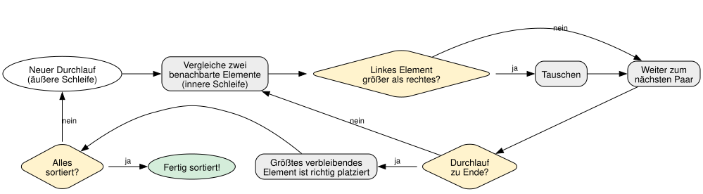
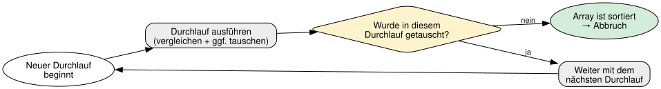

= 11 - Sortieren von Arrays | POS - 1xHIF
:title-separator: |
:lang: de
:revealjs_theme: white
:revealjs_width: 1280
:revealjs_height: 720
:revealjs_transition: none
:revealjs_hash: true
:source-highlighter: highlightjs
:title-slide-background-color: #ED1944
:revealjs_slideNumber: c/t

== Agenda (1/2)

[arabic]
. Warum sortieren?
. Bubblesort - Die Idee
. Beispiel: Schritt 1

== Agenda (2/3)

[arabic, start=4]
. Beispiel: Schritt 2
. Beispiel: Schritt 3
. Bubblesort: Algorithmus
. Verschachtelte for-Schleifen

== Agenda (3/3)

[arabic, start=8]
. Tausch zweier Elemente
. Optimierung: Frühzeitiger Abbruch
. Bubblesort Komplexität

== Lernziele

* Ich kann die Notwendigkeit von Sortieralgorithmen erklären
* Ich kann Bubblesort implementieren und erklären
* Ich kann verschachtelte for-Schleifen verstehen
* Ich kann die Komplexität von Bubblesort einschätzen

== Partneraktivität: Bubblesort mit Karten

[.highlight-box]
--
Nehmt 5 Spielkarten (oder schreibt 5 Zahlen auf Papier). Sortiert sie Schritt für Schritt mit dem Bubblesort-Algorithmus: Eine Person vergleicht, die andere notiert die Durchgänge. Wie viele Durchgänge waren nötig?
--

== Warum sortieren?

* Sortierte Daten sind leichter zu durchsuchen
* Beispiele: Telefonbuch, Notenliste, Highscores
* Sortieren ist eines der grundlegenden Probleme der Informatik
* Es gibt viele Algorithmen — wir lernen den einfachsten: *Bubblesort*

== Bubblesort - Die Idee

[.highlight-box]
--
Größere Elemente "steigen nach oben" wie Blasen im Wasser.
--

* Gehe das Array von links nach rechts durch
* Vergleiche benachbarte Elemente
* Wenn sie in der falschen Reihenfolge sind → *tauschen*
* Nach einem Durchlauf ist das größte Element ganz rechts
* Wiederhole, bis alles sortiert ist

== Beispiel: Schritt 1

[source,java]
----
// Unsortiert: [5, 2, 8, 1, 9]

// 5 > 2 → tauschen → [2, 5, 8, 1, 9]
// 5 > 8 → false  → [2, 5, 8, 1, 9]
// 8 > 1 → tauschen → [2, 5, 1, 8, 9]
// 8 > 9 → false  → [2, 5, 1, 8, 9]
// Nach Durchlauf 1: [2, 5, 1, 8, 9]  (9 ist am richtigen Platz)
----

== Beispiel: Schritt 2

[source,java]
----
// [2, 5, 1, 8, 9]

// 2 > 5 → false  → [2, 5, 1, 8, 9]
// 5 > 1 → tauschen → [2, 1, 5, 8, 9]
// 5 > 8 → false  → [2, 1, 5, 8, 9]
// 8 > 9 → false  → [2, 1, 5, 8, 9]
// Nach Durchlauf 2: [2, 1, 5, 8, 9]
----

== Beispiel: Schritt 3

[source,java]
----
// [2, 1, 5, 8, 9]

// 2 > 1 → tauschen → [1, 2, 5, 8, 9]
// 2 > 5 → false  → [1, 2, 5, 8, 9]
// Nach Durchlauf 3: [1, 2, 5, 8, 9] → fertig sortiert!
----

== Bubblesort: Algorithmus

== Verschachtelte for-Schleifen

* *Äußere Schleife (i):* Bestimmt die Anzahl der Durchläufe
* *Innere Schleife (j):* Vergleicht und tauscht benachbarte Elemente
* Nach jedem Durchlauf ist das größte Element ganz rechts → `arr.length - 1 - i`

== Tausch zweier Elemente

[source,java]
----
// Tausche arr[j] und arr[j+1]
int temp = arr[j];     // Merke den Wert
arr[j] = arr[j + 1];   // Überschreibe Position j
arr[j + 1] = temp;     // Setze gemerkten Wert an Position j+1
----

* Ohne `temp` würde der Wert von `arr++[++j++]++` verloren gehen
* Man braucht eine *Hilfsvariable* zum Zwischenspeichern

== Optimierung: Frühzeitiger Abbruch

* Idee: Wurde in einem ganzen Durchlauf *kein einziges Mal* getauscht, ist das Array schon sortiert
* Dann müssen keine weiteren Durchläufe mehr gemacht werden

== Bubblesort Komplexität

* Im schlimmsten Fall (absteigend sortiert): *O(n²)*
* Im besten Fall (bereits sortiert): *O(n)* (mit Optimierung)
* Bubblesort ist einfach zu verstehen, aber nicht der schnellste Algorithmus
* Trotzdem: Perfekt zum Lernen von Sortieralgorithmen!

== Zusammenfassung

[.highlight-box]
--
* Bubblesort vergleicht und tauscht benachbarte Elemente
* Zwei verschachtelte for-Schleifen steuern den Prozess
* Nach jedem Durchlauf ist das größte Element ganz rechts
* Optimierung: Frühzeitiger Abbruch, wenn kein Tausch mehr nötig
--

== Jahresprojekt: Dungeon Crawler

[.highlight-box]
--
Das Inventar-Array des Spielers soll alphabetisch sortiert werden können. Der Spieler wählt im Menü "Inventar sortieren". Dann wird das Inventar mit Bubblesort sortiert.
--
