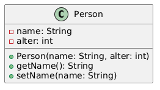
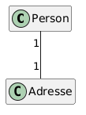
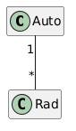
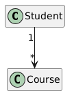
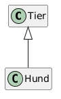
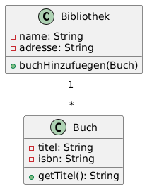

= 21 - UML | POS - 1xHIF
:title-separator: |
:lang: de
:revealjs_theme: white
:revealjs_width: 1280
:revealjs_height: 720
:revealjs_transition: none
:revealjs_hash: true
:source-highlighter: highlightjs
:title-slide-background-color: #ED1944
:revealjs_slideNumber: c/t

== Agenda (1/2)

[arabic]
. Was ist UML?
. Klassendiagramm: Grundform
. Sichtbarkeiten (Visibilitäten)
. Assoziationen

== Agenda (2/3)

[arabic, start=5]
. Multiplizitäten
. Assoziationen in Java
. Gerichtete Assoziation

== Agenda (3/3)

[arabic, start=8]
. Vererbung (Generalisierung)
. Vollständiges Beispiel: Bibliothek
. Vom UML zum Code

== Lernziele

* Ich kann die Notation von Klassendiagrammen lesen
* Ich kann einfache UML-Klassendiagramme erstellen
* Ich kann Beziehungen zwischen Klassen modellieren

== Was ist UML?

UML = **U**nified **M**odeling **L**anguage

* Standardisierte Notation für Softwaredesign
* Visuelle Darstellung von Code-Strukturen
* Hilft beim Planen, Kommunizieren und Dokumentieren

[.highlight-box]
--
UML ist die gemeinsame Sprache zwischen Entwicklern!
--

== Partneraktivität: Ein Klassendiagramm zeichnen

[.highlight-box]
--
Euer Partner beschreibt ein einfaches System (z. B. «eine Bibliothek mit Büchern und Mitgliedern»). Ihr zeichnet das UML-Klassendiagramm auf Papier. Wechselt die Rollen. Vergleicht eure Diagramme — sind sie gleich?
--

== Klassendiagramm: Grundform

Eine Klasse wird als Kasten mit drei Bereichen dargestellt:

== Sichtbarkeiten (Visibilitäten)

Jedes Attribut und jede Methode hat eine Sichtbarkeit:

[cols=",,",options="header",]
|===
|Symbol |Bedeutung |Java
|`{plus}` |public |für alle sichtbar
|`-` |private |nur in der Klasse
|`++#++` |protected |nur in Subklassen
|===

[source,java]
----
public class Person {
    private String name;   // - name
    public String getName() { ... }  // + getName()
}
----

== Assoziationen

Eine Assoziation zeigt eine Beziehung zwischen zwei Klassen.

Eine einfache Linie bedeutet: Person hat eine Adresse.

[source,java]
----
public class Person {
    private Adresse adresse;  // Assoziation
}
----

== Multiplizitäten

Multiplizitäten geben an, wie viele Objekte beteiligt sind.

[cols=",",options="header",]
|===
|Notation |Bedeutung
|1 |genau eines
|++*++ |beliebig viele (0..++*++)
|0..1 |optional (0 oder 1)
|1..++*++ |mindestens eines
|===

== Assoziationen in Java

[source,java]
----
public class Person {
    private Adresse adresse;
}

public class Auto {
    private Rad[] raeder = new Rad[4];
}

public class Bestellung {
    private Kunde kunde;  // kann null sein
}
----

== Gerichtete Assoziation

Ein Pfeil zeigt die Richtung der Beziehung an.

Ein Student besucht beliebig viele Kurse.

[source,java]
----
public class Student {
    private Course[] kurse;
}

public class Course {
    // kennt seine Studenten nicht (keine Referenz)
}
----

== Vererbung (Generalisierung)

Ein Dreieck zeigt die Vererbung an.

[source,java]
----
public class Tier { }
public class Hund extends Tier { }
----

== Vollständiges Beispiel: Bibliothek

[source,java]
----
public class Bibliothek {
    private String name;
    private String adresse;
    private Buch[] buecher;

    public void buchHinzufuegen(Buch b) { ... }
}
----

== Vom UML zum Code

Schritte:

[arabic]
. Jeder Kasten wird eine Klasse
. Attribute werden zu Feldern (mit Typ)
. Methoden werden zu Methoden (mit Rückgabetyp)
. Assoziationen werden zu Referenzen
. Multiplizitäten bestimmen Array oder einzelne Variable

== Zusammenfassung

* UML = Visuelle Darstellung von Code
* Klassendiagramm: Kasten mit Name, Attributen, Methoden
* Sichtbarkeiten: {plus} (public), - (private), ++#++ (protected)
* Assoziationen = Referenzen im Code
* Multiplizitäten = 1, _, 0..1, 1.._

== Übungen

* *Exercise:* UML to Code (Student/Course)

== Jahresprojekt: Dungeon Crawler

[.highlight-box]
--
Erstelle ein UML-Klassendiagramm des gesamten Dungeon Crawlers.
--
