= 02 - Streams, Intro | POS - 3xHIF
:title-separator: |
:lang: en
:revealjs_theme: white
:revealjs_width: 1280
:revealjs_height: 720
:revealjs_transition: none
:revealjs_hash: true
:source-highlighter: highlightjs
:title-slide-background-color: #ED1944
:revealjs_slideNumber: c/t

== Agenda (1/2)

[arabic]
. Motivation: The Problem with Loops
. What is a Stream?
. Stream Pipeline
. From Loop to Stream: Filtering

== Agenda (2/2)

[arabic, start=5]
. From Loop to Stream: Transforming
. From Loop to Stream: Counting & Summing
. forEach
. Summary

== Learning Objectives

* I can explain what a Stream is and how it differs from a loop
* I can recognize common Java 7 loop patterns: filtering, transforming, counting
* I can rewrite simple imperative loops as Stream pipelines
* I can use forEach, filter, and map for basic Stream operations

== Motivation: The Problem with Loops

[source,java]
----
// Java 7 style: find even numbers
List<Integer> even = new ArrayList<>();
for (Integer n : numbers) {
    if (n % 2 == 0) {
        even.add(n);
    }
}
----

[.highlight-box]
--
Every loop repeats the same shape: create a container, iterate, check a condition, mutate. The intent gets buried in bookkeeping.
--

== What is a Stream?

* A sequence of elements supporting sequential/parallel operations
* Not a data structure -- it processes data from a source
* Supports pipelining: chain operations together
* Lazy evaluation: intermediate ops are not executed until a terminal op is called

== Stream Pipeline

[source,java]
----
List<String> result = list.stream()
    .filter(s -> s.startsWith("A"))
    .map(String::toUpperCase)
    .collect(Collectors.toList());
----

== From Loop to Stream: Filtering

[source,java]
----
// Before (Java 7)
List<Integer> even = new ArrayList<>();
for (Integer n : numbers) {
    if (n % 2 == 0) {
        even.add(n);
    }
}

// After
List<Integer> even = numbers.stream()
    .filter(n -> n % 2 == 0)
    .toList();
----

== From Loop to Stream: Transforming

[source,java]
----
// Before (Java 7)
List<String> upper = new ArrayList<>();
for (String word : words) {
    upper.add(word.toUpperCase());
}

// After
List<String> upper = words.stream()
    .map(String::toUpperCase)
    .toList();
----

== From Loop to Stream: Counting & Summing

[source,java]
----
// Before (Java 7)
int sum = 0;
int count = 0;
for (Integer n : numbers) {
    if (n > 0) {
        sum += n;
        count++;
    }
}

// After
long count = numbers.stream().filter(n -> n > 0).count();
int sum = numbers.stream().filter(n -> n > 0).mapToInt(n -> n).sum();
----

== forEach

[source,java]
----
// Before (Java 7)
for (String word : words) {
    System.out.println(word);
}

// After
words.stream().forEach(System.out::println);
----

[.highlight-box]
--
forEach is a terminal operation -- it doesn't return a new Stream.
--

== Summary

* Streams turn "how to iterate" into "what to compute"
* filter selects, map transforms, forEach acts on each element
* Intermediate operations are lazy; nothing runs until a terminal op
* Next: going deeper on filter, map, and flatMap
