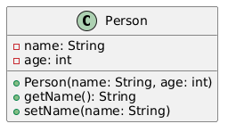
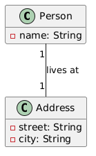
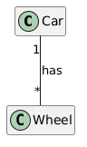
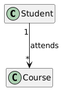
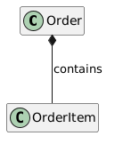
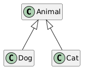
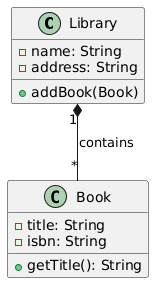

<!-- _class: lead -->

# 04a - UML Class Diagrams
## POS - 3xHIF

---

## Agenda (1/2)

1. What is UML?
2. The Class Box
3. Visibilities
4. Associations
5. Multiplicities

---

## Agenda (2/2)

6. Directed Associations (Navigability)
7. Aggregation
8. Composition
9. Generalization & Realization
10. Full Example: Library
11. From UML to Code

---

## Learning Objectives

- I can read the notation of UML class diagrams
- I can create simple UML class diagrams for a small system
- I can model relationships between classes: association, aggregation, composition, inheritance
- I can translate a class diagram into Java code and explain the difference between the diamonds

---

## What is UML?

UML = **U**nified **M**odeling **L**anguage

- Standardized notation for software design
- Visual representation of code structures
- Helps with planning, communicating, and documenting

<div class="highlight-box"><p>UML is the shared language between developers -- and later in this course it is also the language we use to talk about JPA entity relationships.</p></div>

---

## Class Diagram: The Basic Form

A class is drawn as a box with three compartments: name, attributes, methods.



---

## Visibilities

Every attribute and method has a visibility:

| Symbol | Meaning | Java |
| --- | --- | --- |
| `-` | private | only inside the class |
| `#` | protected | only in subclasses |
| `+` | public | visible to everyone |

```java
public class Person {
    private String name;          // - name : String
    public String getName() { ... }  // + getName() : String
}
```

---

## Association

An association shows a relationship between two classes -- a "has-a" or "knows-a" link.



A simple line means: Person has an Address.

```java
public class Person {
    private Address address;  // association
}
```

---

## Multiplicities

Multiplicities state how many objects participate in the relationship.



| Notation | Meaning |
| --- | --- |
| `1` | exactly one |
| `0..1` | optional (0 or 1) |
| `*` | any number (0..*) |
| `1..*` | at least one |

---

## Associations in Java

```java
public class Person {
    private Address address;      // 1
}

public class Car {
    private Wheel[] wheels = new Wheel[4];  // *
}

public class Order {
    private Customer customer;    // 0..1 -- can be null
}
```

<div class="highlight-box"><p>The multiplicity decides the Java type: a single field, an array/collection, or a nullable reference.</p></div>

---

## Directed Association (Navigability)

An arrow shows the direction of the relationship -- who knows whom.



A Student knows any number of Courses -- but a Course does not know its students.

```java
public class Student {
    private List<Course> courses;
}

public class Course {
    // no reference back to Student
}
```

---

## Aggregation

- A special form of association -- "has-a" with *shared* ownership
- The child can exist independently of the parent
- Drawn with an **empty diamond** on the parent side


```java
public class Department {
    private List<Employee> employees;  // aggregation
}
// Employee survives even if the Department is deleted
```

---

## Composition

- The stronger form -- "has-a" with *exclusive* ownership
- The child **cannot** exist without the parent
- The parent is responsible for the child's lifecycle
- Drawn with a **filled diamond** on the parent side



```java
public class Order {
    private List<OrderItem> items;  // composition
}
// items are created with the Order and destroyed with it
```

---

## Aggregation vs. Composition

| Aspect | Aggregation | Composition |
| --- | --- | --- |
| Ownership | Shared | Exclusive |
| Lifecycle | Child independent | Child depends on parent |
| Diamond | Empty (◊) | Filled (◆) |
| Example | Department + Employee | Order + OrderItem |

<div class="highlight-box"><p>Rule of thumb: if deleting the parent should delete the children, draw a filled diamond.</p></div>

---

## Generalization (Inheritance)

- "is-a" relationship -- line with an **empty triangle**
- The subclass inherits all non-private members
- Java: `extends`



```java
public class Animal { }
public class Dog extends Animal { }
```

---

## Realization (Interfaces)

- Dashed line with an **empty triangle**
- The class implements the interface
- Java: `implements`


```java
public interface Borrowable { }
public class Book implements Borrowable { }
```

---

## All Symbols at a Glance

| Symbol | Name | Meaning |
| --- | --- | --- |
| `—` line | Association | knows / has, no ownership |
| `→` arrow | Directed association | navigable one way only |
| `◊—` empty diamond | Aggregation | shared ownership, independent lifecycle |
| `◆—` filled diamond | Composition | exclusive ownership, shared lifecycle |
| `△` empty triangle | Generalization | inheritance (`extends`) |
| `△` on dashed line | Realization | interface (`implements`) |

---

## Full Example: Library



```java
public class Library {
    private String name;
    private String address;
    private List<Book> books;  // composition: books belong to this library

    public void addBook(Book b) { ... }
}
```

---

## From UML to Code

Steps:

1. Each box becomes a class
2. Attributes become fields (with type and visibility)
3. Methods become methods (with return type)
4. Associations become references (fields or collections)
5. The multiplicity decides: single field, collection, or nullable reference
6. The diamond decides: does the owner create and destroy the other object?

---

## Summary

- UML = visual representation of code structures
- Class box: name, attributes, methods; visibility `-` `#` `+`
- Association = reference in code; multiplicities: `1`, `0..1`, `*`, `1..*`
- Empty diamond = aggregation (shared ownership), filled diamond = composition (exclusive ownership)
- Empty triangle = inheritance; dashed triangle = interface realization
- Next: Streams, going deeper with collectors
