= 19 - Git Collaboration | POS - Advanced
:title-separator: |
:lang: de
:revealjs_theme: white
:revealjs_width: 1280
:revealjs_height: 720
:revealjs_transition: none
:revealjs_hash: true
:source-highlighter: highlightjs
:title-slide-background-color: #ED1944
:revealjs_slideNumber: c/t

== Agenda (1/2)

[arabic]
. Remote-Repositories — Konzept
. Remote-Grundbefehle
. git clone — Repository kopieren
. git pull — Änderungen übernehmen
. Pull Requests — Konzept
. Pull Requests — Ablauf
. Pull Requests — Beispiel
. Code Review — Autor:innen
. Code Review — Reviewer

== Agenda (2/2)

[arabic, start=10]
. Branching-Strategien — Überblick
. GitFlow — Architektur
. GitFlow — Branches
. GitFlow — Arbeitsablauf
. GitHub Flow — Einfach & Effizient
. Forking-Workflow
. Forking — Beispiel
. Git in CI/CD
. CI/CD — Beispiel

== Lernziele

* Ich kann mit Remote-Repositories arbeiten (clone, pull, push)
* Ich kenne den Ablauf eines Pull Requests inklusive Code Review
* Ich kann GitFlow und GitHub Flow als Branching-Strategien unterscheiden
* Ich kenne den Forking-Workflow für externe Beiträge
* Ich verstehe die Rolle von Git in CI/CD-Pipelines

== Remote-Repositories — Konzept

* *Remote:* Eine Kopie des Repositories auf einem anderen Rechner/Server
* Ermöglicht synchronisierte Teamarbeit
* Typische Dienste: GitHub, GitLab, Bitbucket, Gitea
* Standard-Name für das Haupt-Remote: `origin`

== Remote-Grundbefehle

[source,bash]
----
# Repository kopieren
git clone https://github.com/benutzer/projekt.git

# Änderungen holen (ohne zu mergen)
git fetch origin

# Änderungen holen & mergen
git pull origin main

# Lokale Commits hochladen
git push origin main
----

* `fetch` holt Daten, `pull` = fetch {plus} merge
* `push` überträgt lokale Commits zum Remote

== git clone — Repository kopieren

[source,bash]
----
# Vollständige lokale Kopie erstellen
git clone https://github.com/beispiel/projekt.git
cd projekt
----

* Nach `git clone` ist `origin` automatisch als Remote gesetzt
* `origin/main` ist der Remote-Tracking-Branch (nicht direkt bearbeitbar)

== git pull — Änderungen übernehmen

[source,bash]
----
# Kurzform: holen & mergen
git pull origin main

# Mit Kontrolle: erst holen, dann mergen
git fetch origin
git log --oneline main..origin/main
git merge origin/main
----

* Fetch {plus} Log gibt Kontrolle, bevor gemergt wird

== Pull Requests — Konzept

* *Pull Request (PR) / Merge Request (MR):* Bitte, Änderungen in einen anderen Branch zu übernehmen
* PRs ermöglichen *Code Review* vor dem Merge

== Pull Requests — Ablauf

[arabic]
. Branch für Feature erstellen
. Änderungen committen & pushen
. PR auf GitHub/GitLab öffnen (feature → main)
. Teamkollegen reviewen den Code
. PR wird gemergt (oder abgelehnt)

== Pull Requests — Beispiel

[source,bash]
----
git switch -c feature/login
git add -A && git commit -m "Login hinzugefügt"
git push origin feature/login
git switch main
git pull origin main
----

[.highlight-box]
--
PRs sind kein Git-Feature, sondern eine Funktion der Plattform (GitHub/GitLab)
--

== Code Review — Autor:innen

* Kleine, fokussierte PRs (max. 200-300 Zeilen)
* Aussagekräftige PR-Beschreibung (Was? Warum? Wie getestet?)
* Auf Feedback eingehen & nachbessern

== Code Review — Reviewer

* Konstruktives Feedback (nicht die Person kritisieren)
* Auf Architektur, Sicherheit, Testabdeckung achten
* Bei Unklarheiten nachfragen statt raten
* Typische PR-Checks: CI-Pipelines, Linting, automatisierte Tests

== Branching-Strategien — Überblick

[cols=",,",options="header",]
|===
|Strategie |Komplexität |Anwendung
|GitFlow |Hoch |Große Projekte, Release-Zyklen
|GitHub Flow |Niedrig |Continuous Delivery, Web-Apps
|Trunk-Based |Niedrig |CI/CD, kurze Feature-Branches
|GitLab Flow |Mittel |Umgebungs-basierte Deployments
|Forking |Mittel |Open Source, externe Beiträge
|===

== GitFlow — Architektur

== GitFlow — Branches

* *main:* Produktionsreifer Code (jeder Commit = Release)
* *develop:* Integrationsbranch für die nächste Version
* ++**++feature/++*++:++**++ Neue Features (werden in develop gemergt)
* ++**++release/++*++:++**++ Vorbereitung eines Releases (Bugfixes, Metadaten)
* ++**++hotfix/++*++:++**++ Dringende Bugfixes für die Produktion

== GitFlow — Arbeitsablauf

[source,bash]
----
# 1. Feature entwickeln
git switch -c feature/neues-feature develop
# ... Arbeit ...
git push origin feature/neues-feature
# PR feature/neues-feature → develop

# 2. Release vorbereiten
git switch -c release/1.2.0 develop
# Letzte Anpassungen (Version, Changelog)
git push origin release/1.2.0
# PR release/1.2.0 → main  (+ zurück nach develop)

# 3. Hotfix
git switch -c hotfix/1.2.1 main
# Bugfix
git push origin hotfix/1.2.1
# PR hotfix/1.2.1 → main  (+ zurück nach develop)
----

== GitHub Flow — Einfach & Effizient

* Nur *ein* Haupt-Branch: `main`
* Jedes Feature/ jeder Fix: Branch von main → PR zurück zu main
* Nach Merge: Sofort deployen (Continuous Delivery)

[arabic]
. Branch von main
. Commits
. PR öffnen (early!)
. Review & Diskussion
. Merge & Deploy

== Forking-Workflow

* Fork = persönliche Kopie eines fremden Repositories auf dem Server
* Typisch für Open Source: Externe können nicht direkt pushen

== Forking — Beispiel

[source,bash]
----
git clone https://github.com/DEIN-USER/projekt.git
cd projekt
git remote add upstream https://github.com/ORIGINAL/projekt.git
git switch -c feature/xyz
# ... Änderungen ...
git push origin feature/xyz
git fetch upstream
git merge upstream/main
----

== Git in CI/CD

* CI/CD-Pipelines nutzen Git als Trigger und Informationsquelle
* Typische CI-Ereignisse: `push`, `pull++_++request`, `tag`
* `$GIT++_++COMMIT` — aktueller Commit-SHA
* `$GIT++_++BRANCH` — aktueller Branch-Name
* `$GIT++_++TAG++_++NAME` — Tag-Name (bei Tag-Ereignissen)

== CI/CD — Beispiel

[source,yaml]
----
on:
  push:
    branches: [main]
  pull_request:
    branches: [main]

jobs:
  build:
    runs-on: ubuntu-latest
    steps:
      - uses: actions/checkout@v4
      - run: ./gradlew build
----

== Zusammenfassung

* *Remote-Repos:* `clone`, `fetch`, `pull`, `push`
* *Pull Requests:* Code Review vor dem Merge
* *GitFlow:* Strukturierte Branches (main, develop, feature, release, hotfix)
* *GitHub Flow:* Einfach — ein Haupt-Branch {plus} PRs
* *Forking:* Externe Beiträge ohne direkten Schreibzugriff
* *CI/CD:* Git als Grundlage für automatisierte Builds & Deployments
